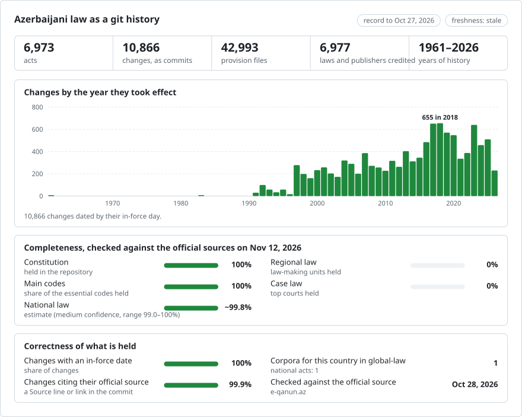

# Azerbaijan: law history in git

**English** · **[Və ya azərbaycanca oxuyun](README.md)**

<picture>
<source media="(prefers-color-scheme: dark)" srcset="data/effort-dark.svg">

</picture>

The law of Azerbaijan as a git history: one file per article, one commit per change on the day it took effect, and the act that made each change as the commit's author. `git blame` names the act behind every paragraph; `git log` lists every change to an article; picking a date gives the text in force that day.

Part of [lexifina/global-law](https://github.com/lexifina/global-law), one git history for every country's law: this is Azerbaijan's national law, which global-law reads at `azerbaijan/national/acts/`.

**What is in it now:** the Constitution, the 3 referendum acts that amended it, 56 constitutional laws, 23 codes and 6,890 laws from e-qanun.az, in force and repealed, with 7,887 texts (each act's current text and every dated edition e-qanun keeps of it); 6,601 of these acts are in force on `main`. [`laws.csv`](laws.csv) lists every act with its e-qanun link.

Each act is in `<kind>/<year adopted>/<official number>/`, or its e-qanun number where it has none (`mecelle/1999/46943/` is the Əmək Məcəlləsi, the Labour Code; the Constitution is [`konstitusiya/1995/897/`](konstitusiya/1995/897/)), with one file per article (`madde-114.md`; Article 98¹ is `madde-98-1.md`) and `title.md` for the text before the first article. Until 10 November 2026 the folders were named by kind and e-qanun number (`code/46943/`); [`data/paths.json`](data/paths.json) maps each to its folder.

The text is in Azerbaijani (Latin script), the authoritative original, as e-qanun.az publishes it, with e-qanun's notes on each article at the end of its file. An English translation is not part of this record.

## Questions as git commands

| Question | Command |
| --- | --- |
| Every change to Article 114 of the Labour Code (basic leave) | `git log -p --follow --word-diff -- mecelle/1999/46943/madde-114.md` |
| Which act wrote each line of Article 114? | `git blame mecelle/1999/46943/madde-114.md` |
| Every version of the Labour Code, with the day each took effect | `git log --format="%h %(trailers:key=In-force,valueonly,separator=) %an" -- mecelle/1999/46943 code/46943` |
| Article 114 as in force on 1 January 2010 | `python tools/in_force_on.py 2010-01-01 code/46943 114` |

**Outside git**, we also host this record publicly, for free:

- **[Ask Claude about Azerbaijani law](https://global-law.lexifina.com/v1/try_claude?country=azerbaijan)**: opens Claude with a first question ready.
- **[Ask ChatGPT](https://global-law.lexifina.com/v1/try_chatgpt?country=azerbaijan)**: the same question in ChatGPT.
- **[Call the API in your browser](https://global-law.lexifina.com/v1/search_law?query=m%C9%99zuniyy%C9%99t&jurisdictions=azerbaijan)**: a search of Azerbaijani law for "məzuniyyət", returned as JSON. See the [documentation here](https://lexifina.com/api/global-law).

Both assistants read the record through the free Global law connector (MCP, `https://global-law.lexifina.com/mcp`); the first time, the chat gives you the link that adds it. Ask in Azerbaijani or in English.

**Host it yourself easily.** All it takes is git and Python, and the tools run on your machine:

```sh
git clone --depth 1 https://github.com/lexifina/global-law && cd global-law
python3 tools/countries.py add azerbaijan/national/acts
python3 tools/law.py show 2026-01-01 azerbaijan/national/acts/mecelle/1999/46943/madde-114.md
```

Opened in Claude Code, Cursor, VS Code or Codex, the clone also starts a local MCP server with the same tools ([MCP.md](https://github.com/lexifina/global-law/blob/main/MCP.md)).

## Dates

Each commit is dated at noon, Asia/Baku (+04:00), on the day the change took effect, and carries it in its `In-force:` trailer:

- e-qanun's in-force date ("Qüvvəyə minmə tarixi") for the act that made the change;
- where e-qanun gives none (2,043 acts, mostly before 2005), the act's first official publication, the day a law takes effect unless it sets a later one (Constitutional Law No. 21-IVKQ on Normative Legal Acts, article 85.1); for the few with neither, its adoption day. `In-force-basis:` says which;
- changes that take effect after the build day (2026-10-28) are on the `future` branch, which is never merged into `main`;
- git cannot store dates before 1970, so the one earlier version (the 1961 Criminal Code of the Azerbaijan SSR) is dated 1970-01-01, with its real day in `In-force:`.

Each change is credited to the act that e-qanun's notes on the changed article name, by its official number and adoption day (`Qanun 452-VIIQD (14.07.2026)`). Where the notes name several acts or none, it is credited to `e-qanun.az (Ministry of Justice of Azerbaijan)` and labelled `Kind: several` (1,041 commits, the acts listed as `Candidate:`) or `Kind: unexplained` (212).

## How it is checked

- `tools/build/check_repo.py`: the final text of every act equals e-qanun's current text, file for file, and repealed acts are gone; the words of every source text, read separately from the raw HTML, equal the files built from it.
- `tools/in_force_on.py` was compared with e-qanun's own dated editions on the day of each change and the day before.
- Every commit's trailers parse; `main` has no merge commits, its commit dates never go backwards, and none is after the build day.
- Two builds from the same retrieved texts give the same commit hashes; the sha256 of every downloaded text is in `data/texts-sha256.tsv`. Results are in [`REPRODUCE.md`](REPRODUCE.md).

## What it does not show

- **Wording older than e-qanun's first kept text.** e-qanun keeps dated editions mostly from 2021, and the act as adopted for 300 of the 6,973 acts. An article amended before that appears only from the in-force day of the latest act its notes name (`Kind: baseline`, 2,625 commits), so on an earlier date it is missing, not wrong; the Constitution's 2002, 2009 and 2016 amendments are such commits.
- **Sub-laws:** presidential decrees and orders, Cabinet decisions and ministerial acts.
- **267 repealed acts** for which e-qanun names no repealing act, and 2 texts it could not serve ([`data/issues.csv`](data/issues.csv)).
- **Each act's words in a paragraph two acts changed:** blame names only the later act; `git log -p --word-diff` shows both.
- **e-qanun's links, images and Russian and English translations.** A renumbered article shows as one file removed and another added.

## Sources

| Source | Kind | Past versions | Notes |
| --- | --- | --- | --- |
| [e-qanun.az](https://e-qanun.az) (Ministry of Justice) | Official database of legal acts (Hüquqi Aktların Vahid İnternet Elektron Məlumat Bazası) | yes, dated editions, mostly from 2021 | Read through its open JSON API: each act's current text, editions, requisites and related acts |

## Licence

See [`LICENSE`](LICENSE). Under article 7(a) of the Law on Copyright and Related Rights (No. 115-IQ, 5 June 1996), laws and other official texts of a legislative, administrative or judicial nature are not objects of copyright; e-qanun publishes no terms of use. Lexifina's own contributions (tools, file arrangement, commit messages and documentation) are CC0 1.0.

No AI model reads, writes, summarises or classifies any legal text; the scripts and documentation were written by an AI model (see [`REPRODUCE.md`](REPRODUCE.md)).

## More

From [lexifina/global-law](https://github.com/lexifina/global-law):

- [FEATURES.md](https://github.com/lexifina/global-law/blob/main/FEATURES.md): every feature, and what every corpus must support (`git blame`, `law.py`, the MCP tools)
- [FAQ.md](https://github.com/lexifina/global-law/blob/main/FAQ.md): questions and answers · [CONTRIBUTING.md](https://github.com/lexifina/global-law/blob/main/CONTRIBUTING.md): proposing changes · [MCP.md](https://github.com/lexifina/global-law/blob/main/MCP.md): the MCP server · [REPRODUCE.md](https://github.com/lexifina/global-law/blob/main/REPRODUCE.md): how it was built · [CHANGELOG.md](https://github.com/lexifina/global-law/blob/main/CHANGELOG.md)
- [FRESHNESS.md](https://github.com/lexifina/global-law/blob/main/FRESHNESS.md): how current each corpus is · [Monitoring](https://github.com/lexifina/global-law/tree/main/monitoring): whether updates are running · [WATCHING.md](https://github.com/lexifina/global-law/blob/main/WATCHING.md): how each official source is watched for changes
- [performance/](https://github.com/lexifina/global-law/tree/main/performance): how fast the tools are, measured
- [visualisations/](https://github.com/lexifina/global-law/tree/main/visualisations): charts and bridges across the world's law
- [Vulnerabilities](https://github.com/lexifina/global-law/tree/main/vulnerabilities): mistakes in legislation as published
