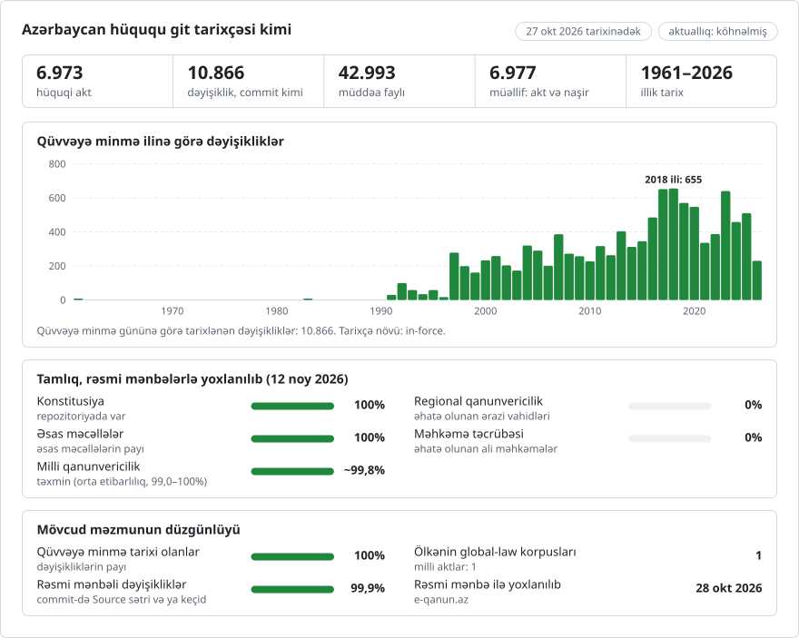

# Azərbaycan: qanunvericiliyin tarixçəsi git-də

**Azərbaycanca** · **[Or read it in English](README.en.md)**

<picture>
<source media="(prefers-color-scheme: dark)" srcset="data/az/effort-dark.svg">

</picture>

Azərbaycan qanunvericiliyi git tarixçəsi kimi: hər maddə üçün bir fayl, hər dəyişiklik üçün qüvvəyə mindiyi gün bir commit, commitin müəllifi isə həmin dəyişikliyi edən aktdır. `git blame` hər abzasın arxasındakı aktı göstərir; `git log` maddəyə edilmiş hər dəyişikliyi sadalayır; tarix seçdikdə həmin gün qüvvədə olan mətn alınır.

[lexifina/global-law](https://github.com/lexifina/global-law) layihəsinin, yəni bütün ölkələrin qanunvericiliyi üçün vahid git tarixçəsinin bir hissəsi: bu, Azərbaycanın milli qanunvericiliyidir və global-law onu `azerbaijan/national/acts/` ünvanında oxuyur.

**Hazırda nələr var:** e-qanun.az-dan Konstitusiya, ona dəyişiklik edən 3 referendum aktı, 56 konstitusiya qanunu, 23 məcəllə və 6.890 qanun, qüvvədə olan və qüvvədən düşmüş, 7.887 mətnlə (hər aktın cari mətni və e-qanunun onun saxladığı bütün tarixli redaksiyaları); bu aktlardan 6.601-i `main`-də qüvvədədir. [`laws.csv`](laws.csv) bütün aktları e-qanun keçidləri ilə sadalayır.

Hər akt `<növ>/<qəbul ili>/<rəsmi nömrə>/` qovluğundadır, rəsmi nömrəsi olmayan akt isə e-qanun nömrəsi ilə (`mecelle/1999/46943/` Əmək Məcəlləsidir; Konstitusiya [`konstitusiya/1995/897/`](konstitusiya/1995/897/) qovluğundadır); içində hər maddə üçün bir fayl (`madde-114.md`; 98¹-ci maddə `madde-98-1.md` olur) və birinci maddədən əvvəlki mətn üçün `title.md` var. 2026-cı il noyabrın 10-dək qovluqlar növ və e-qanun nömrəsi ilə adlanırdı (`code/46943/`); [`data/paths.json`](data/paths.json) hər birini indiki qovluğuna uyğunlaşdırır.

Mətn Azərbaycan dilində (latın qrafikası ilə), mötəbər orijinal mətndir, e-qanun.az-ın dərc etdiyi kimi; hər maddəyə dair e-qanun qeydləri onun faylının sonundadır. İngilis dilinə tərcümə bu qeydin hissəsi deyil.

## Suallar git əmrləri kimi

| Sual | Əmr |
| --- | --- |
| Əmək Məcəlləsinin 114-cü maddəsinə (əsas məzuniyyət) edilmiş hər dəyişiklik | `git log -p --follow --word-diff -- mecelle/1999/46943/madde-114.md` |
| 114-cü maddənin hər sətrini hansı akt yazıb? | `git blame mecelle/1999/46943/madde-114.md` |
| Əmək Məcəlləsinin hər redaksiyası, hər birinin qüvvəyə mindiyi günlə | `git log --format="%h %(trailers:key=In-force,valueonly,separator=) %an" -- mecelle/1999/46943 code/46943` |
| 114-cü maddə 2010-cu il yanvarın 1-də qüvvədə olduğu kimi | `python tools/in_force_on.py 2010-01-01 code/46943 114` |

**Git-dən kənarda** bu qeydi həm də ictimai və pulsuz yerləşdiririk:

- **[Claude-dan Azərbaycan qanunvericiliyi barədə soruşun](https://global-law.lexifina.com/v1/try_claude?country=azerbaijan)**: Claude-u hazır ilk sualla açır.
- **[ChatGPT-dən soruşun](https://global-law.lexifina.com/v1/try_chatgpt?country=azerbaijan)**: eyni sual ChatGPT-də.
- **[API-ni brauzerdə çağırın](https://global-law.lexifina.com/v1/search_law?query=m%C9%99zuniyy%C9%99t&jurisdictions=azerbaijan)**: Azərbaycan qanunvericiliyində "məzuniyyət" axtarışı, cavab JSON şəklində. Sənədlər [buradadır](https://lexifina.com/api/global-law).

Hər iki assistent qeydi pulsuz Global law konnektoru (MCP, `https://global-law.lexifina.com/mcp`) vasitəsilə oxuyur; ilk dəfə söhbət onu əlavə edən keçidi verir. Azərbaycan və ya ingilis dilində soruşun.

**Asanlıqla özünüz işə salın.** Yalnız git və Python lazımdır, alətlər isə sizin kompüterinizdə işləyir:

```sh
git clone --depth 1 https://github.com/lexifina/global-law && cd global-law
python3 tools/countries.py add azerbaijan/national/acts
python3 tools/law.py show 2026-01-01 azerbaijan/national/acts/mecelle/1999/46943/madde-114.md
```

Claude Code, Cursor, VS Code və ya Codex-də açıldıqda klon eyni alətlərlə yerli MCP serverini də işə salır ([MCP.md](https://github.com/lexifina/global-law/blob/main/MCP.md)).

## Tarixlər

Hər commit dəyişikliyin qüvvəyə mindiyi gün, Bakı vaxtı ilə (Asia/Baku, +04:00) günorta tarixlənir və həmin gün onun `In-force:` treylerində göstərilir:

- dəyişikliyi edən akt üçün e-qanunun göstərdiyi qüvvəyə minmə tarixi ("Qüvvəyə minmə tarixi");
- e-qanun belə tarix göstərmədikdə (2.043 akt, əsasən 2005-ci ildən əvvəlki), aktın ilk rəsmi dərci, çünki qanun daha gec tarix müəyyən etmədikdə həmin gün qüvvəyə minir ("Normativ hüquqi aktlar haqqında" № 21-IVKQ Konstitusiya Qanunu, maddə 85.1); hər ikisi olmayan bir neçə akt üçün qəbul günü. Hansının götürüldüyünü `In-force-basis:` göstərir;
- qurma günündən (2026-10-28) sonra qüvvəyə minən dəyişikliklər `future` budağındadır və bu budaq heç vaxt `main`-ə birləşdirilmir;
- git 1970-ci ildən əvvəlki tarixləri saxlaya bilmir, ona görə də daha əvvəlki yeganə redaksiya (Azərbaycan SSR-in 1961-ci il Cinayət Məcəlləsi) 1970-01-01 tarixi ilə qeydə alınıb, həqiqi günü isə `In-force:` treylerindədir.

Hər dəyişiklik dəyişən maddəyə dair e-qanun qeydlərinin adlandırdığı akta, onun rəsmi nömrəsi və qəbul günü ilə aid edilir (`Qanun 452-VIIQD (14.07.2026)`). Qeydlər bir neçə aktı adlandırdıqda və ya heç birini adlandırmadıqda dəyişiklik `e-qanun.az (Ministry of Justice of Azerbaijan)`-a aid edilir və `Kind: several` (1.041 commit, aktlar `Candidate:` kimi sadalanır) və ya `Kind: unexplained` (212) kimi etiketlənir.

## Necə yoxlanılır

- `tools/build/check_repo.py`: hər aktın son mətni fayl-fayl e-qanundakı cari mətnə bərabərdir, qüvvədən düşmüş aktlar isə çıxarılıb; xam HTML-dən ayrıca oxunan hər mənbə mətninin sözləri ondan qurulan fayllara bərabərdir.
- `tools/in_force_on.py` hər dəyişikliyin günündə və ondan bir gün əvvəl e-qanunun öz tarixli redaksiyaları ilə müqayisə edilib.
- Hər commitin treylerləri düzgün təhlil olunur; `main`-də birləşmə (merge) commitləri yoxdur, onun commit tarixləri heç vaxt geri getmir və heç biri qurma günündən sonraya düşmür.
- Eyni əldə edilmiş mətnlərdən iki quruluş eyni commit heşlərini verir; hər yüklənmiş mətnin sha256 dəyəri `data/texts-sha256.tsv` faylındadır. Nəticələr [`REPRODUCE.md`](REPRODUCE.md) faylındadır.

## Nəyi göstərmir

- **e-qanunun saxladığı ilk mətndən daha köhnə redaksiyanı.** e-qanun tarixli redaksiyaları əsasən 2021-ci ildən, aktın qəbul edildiyi mətni isə 6.973 aktdan 300-ü üçün saxlayır. Bundan əvvəl dəyişdirilmiş maddə yalnız qeydlərinin adlandırdığı ən son aktın qüvvəyə minmə günündən görünür (`Kind: baseline`, 2.625 commit), ona görə də daha erkən tarixdə o səhv deyil, sadəcə yoxdur; Konstitusiyanın 2002, 2009 və 2016-cı il dəyişiklikləri də belə commitlərdir.
- **Qanundan aşağı aktları:** prezident fərmanları və sərəncamları, Nazirlər Kabinetinin qərarları və nazirlik aktları.
- **e-qanunun ləğv edən aktı adlandırmadığı 267 qüvvədən düşmüş aktı** və onun təqdim edə bilmədiyi 2 mətni ([`data/issues.csv`](data/issues.csv)).
- **İki aktın dəyişdirdiyi abzasda hər aktın sözlərini:** blame yalnız sonrakı aktı göstərir; `git log -p --word-diff` hər ikisini göstərir.
- **e-qanunun keçidlərini, şəkillərini, rus və ingilis dillərinə tərcümələrini.** Yeni nömrəyə keçən maddə bir faylın silinməsi və digərinin əlavə edilməsi kimi görünür.

## Mənbələr

| Mənbə | Növ | Əvvəlki redaksiyalar | Qeydlər |
| --- | --- | --- | --- |
| [e-qanun.az](https://e-qanun.az) (Ədliyyə Nazirliyi) | Hüquqi Aktların Vahid İnternet Elektron Məlumat Bazası | bəli, tarixli redaksiyalar, əsasən 2021-ci ildən | Açıq JSON API-si vasitəsilə oxunur: hər aktın cari mətni, redaksiyaları, rekvizitləri və əlaqəli aktları |

## Lisenziya

[`LICENSE`](LICENSE) faylına baxın. "Müəllif hüququ və əlaqəli hüquqlar haqqında" Qanunun (№ 115-IQ, 5 iyun 1996-cı il) 7-ci maddəsinin a) bəndinə əsasən qanunlar və qanunvericilik, inzibati və ya məhkəmə xarakterli digər rəsmi mətnlər müəllif hüququnun obyekti deyil; e-qanun istifadə şərtləri dərc etmir. Lexifina-nın öz töhfələri (alətlər, faylların tərtibatı, commit mesajları və sənədlər) CC0 1.0 lisenziyası altındadır.

Heç bir süni intellekt modeli heç bir hüquqi mətni oxumur, yazmır, xülasə etmir və ya təsnif etmir; skriptləri və sənədləri süni intellekt modeli yazıb ([`REPRODUCE.md`](REPRODUCE.md) faylına baxın).

Bu, ingilis dilindəki versiyanın ([README.en.md](README.en.md)) tərcüməsidir; fərq olarsa, ingilis versiyası üstündür.

## Ətraflı

[lexifina/global-law](https://github.com/lexifina/global-law) repozitoriyasından (ingilis dilində):

- [FEATURES.md](https://github.com/lexifina/global-law/blob/main/FEATURES.md): bütün funksiyalar və hər korpusun dəstəkləməli olduqları (`git blame`, `law.py`, MCP alətləri)
- [FAQ.md](https://github.com/lexifina/global-law/blob/main/FAQ.md): suallar və cavablar · [CONTRIBUTING.md](https://github.com/lexifina/global-law/blob/main/CONTRIBUTING.md): dəyişiklik təklif etmək · [MCP.md](https://github.com/lexifina/global-law/blob/main/MCP.md): MCP serveri · [REPRODUCE.md](https://github.com/lexifina/global-law/blob/main/REPRODUCE.md): necə qurulub · [CHANGELOG.md](https://github.com/lexifina/global-law/blob/main/CHANGELOG.md)
- [FRESHNESS.md](https://github.com/lexifina/global-law/blob/main/FRESHNESS.md): hər korpusun nə dərəcədə aktual olduğu · [Monitorinq](https://github.com/lexifina/global-law/tree/main/monitoring): yeniləmələrin işləyib-işləmədiyi · [WATCHING.md](https://github.com/lexifina/global-law/blob/main/WATCHING.md): hər rəsmi mənbənin dəyişikliklər üçün necə izlənildiyi
- [performance/](https://github.com/lexifina/global-law/tree/main/performance): alətlərin ölçülmüş sürəti
- [visualisations/](https://github.com/lexifina/global-law/tree/main/visualisations): bütün dünya hüququ üzrə qrafiklər və əlaqələr
- [Zəifliklər](https://github.com/lexifina/global-law/tree/main/vulnerabilities): dərc olunduğu kimi aktlardakı səhvlər
