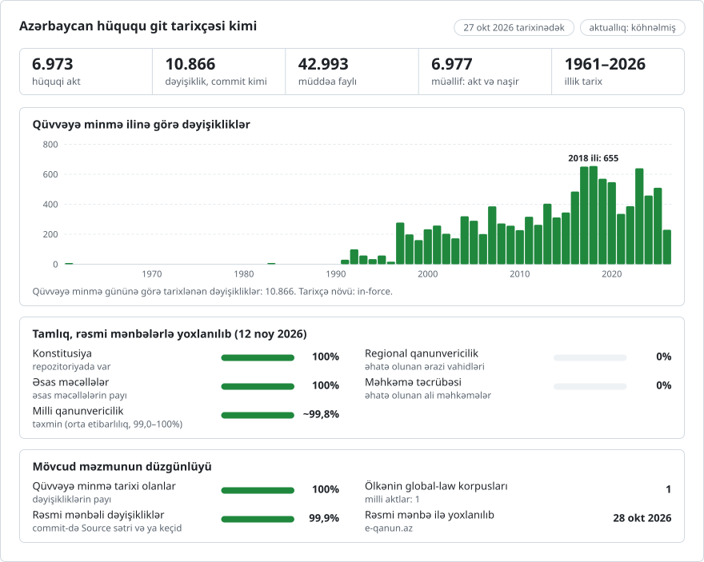

# Azərbaycan qanunvericiliyi, dəyişiklik-dəyişiklik

**Azərbaycanca** · [English](README.en.md)

<picture>
<source media="(prefers-color-scheme: dark)" srcset="data/az/effort-dark.svg">

</picture>

[lexifina/global-law](https://github.com/lexifina/global-law) layihəsinin, yəni hər ölkənin qanunvericiliyi üçün vahid git tarixçəsinin bir hissəsi: bu, Azərbaycanın milli qanunvericiliyidir və global-law onu `azerbaijan/national/acts/` ünvanında oxuyur.

Azərbaycan Respublikasının milli qanunvericiliyi git repozitoriyası kimi: Konstitusiya, ona dəyişiklik edən 3 referendum aktı, 56 konstitusiya qanunu, 23 məcəllə və 6.890 qanun, qüvvədə olan və qüvvədən düşmüş, Azərbaycan Respublikası Ədliyyə Nazirliyinin Hüquqi Aktların Vahid İnternet Elektron Məlumat Bazası olan [e-qanun.az](https://e-qanun.az) saytından. Hər maddə ayrıca fayldır, hər sətirdə bir abzas. Hər dəyişiklik onu edən akta aid edilmiş və qüvvəyə mindiyi günün tarixi ilə, Bakı vaxtı ilə günorta qeydə alınmış bir commitdir. Mətn Azərbaycan dilindəki orijinaldır, yəni mötəbər mətndir.

`main` budağında qeydlər 1961-03-01 tarixindən 2026-10-27 tarixinədək 10.867 commitdən ibarətdir və 7.887 mətndən qurulub: hər aktın cari mətni və e-qanunun onun saxladığı bütün tarixli redaksiyaları. Daha 12 commit qurma günündən (2026-10-28) sonra qüvvəyə minir və `future` budağındadır.

## Hüquqşünasın sualları git əmrləri kimi

| Sual | Əmr |
| --- | --- |
| Dövlət satınalmaları haqqında Qanunun 1-ci maddəsi 2022-ci il yanvarın 1-də nə deyirdi? | `python tools/in_force_on.py 2022-01-01 law/1029 1` |
| Bütün Mülki Məcəllə müəyyən tarixdə | `python tools/in_force_on.py 2024-06-01 code/46944` |
| Maddənin hər abzasını sonuncu dəfə hansı akt dəyişib? | `git blame code/46944/madde-107.md` |
| Maddəyə edilmiş hər dəyişiklik, onun arxasındakı aktla birlikdə | `git log -p code/46944/madde-107.md` |
| Bütöv abzaslar deyil, dəyişən sözlər | `git log -p --word-diff code/46944/madde-107.md` |
| Bir aktın bütün qanunlarda dəyişdirdiyi hər şey | `git log --author='452-VIIQD' --stat` |
| Qanunu dəyişdirən bütün aktlar, ardıcıllıqla | `git log --format='%(trailers:key=In-force,valueonly,separator=) %an' -- code/46944` |
| Bu gündən sonra qüvvəyə minənlər | `git log main..future` |
| Aktların siyahısı, e-qanun keçidləri ilə | [`laws.csv`](laws.csv) |

"Bu tarixdə" sualları üçün `git log --before` əvəzinə `tools/in_force_on.py` istifadə edin. O, mətni `In-force:` treylerinə görə seçir, ona görə də istənilən saat qurşağında düzgün nəticə verir. Xam git istifadə edirsinizsə, vaxtı tam yazın: `git rev-list -1 --before="2022-01-01T23:59:59+04:00" main`. PowerShell-də `git show "$(git rev-list -1 --before=... main):law/1029/madde-1.md"` əmrində dırnaq işarələri lazımdır. Yolları skan edərkən git-ə `-c core.quotepath=false` parametrini ötürün.

Qovluqlar `constitution/`, `referendum-act/`, `constitutional-law/`, `code/` və `law/`-dır; hər aktın qovluğu onun e-qanun nömrəsi ilə, yəni `e-qanun.az/framework/N` ünvanındakı `N` ilə adlandırılır. Onun içində hər maddə üçün bir fayl var (`madde-4.md`, `madde-13-1.md`; Konstitusiyadakı 98¹ kimi yuxarı indekslə nömrələnmiş maddə `madde-98-1.md` olur, yəni aktların ona istinad edərkən işlətdiyi forma: "98-1-ci maddə"), birinci maddədən əvvəlki mətn üçün isə `title.md`. Bölmə və fəsillərin başlıqları onlardan əvvəlki maddənin sonunda qalır. Maddələri olmayan akt bütövlükdə `title.md` faylındadır.

Hər fayl e-qanunun həmin maddəyə dair qeydləri ilə bitir; qeydlər hər faylda `[^1]`, `[^2]` ... kimi yenidən nömrələnir, qeydin işarəsi isə e-qanunun onu göstərdiyi yerdə saxlanılır. Qeyd dəyişikliyi edən aktı adlandırır və çox vaxt əvvəlki redaksiyanı sitat gətirir ("Əvvəlki redaksiyada deyilirdi: ..."). Hər qeydin içindəki rəsmi dərc istinadı ("“Azərbaycan” qəzeti, ..., Qanunvericilik Toplusu, ...") çıxarılıb, çünki e-qanun onu dəyişiklikdən sonrakı aylar ərzində doldurur; aktın dərc tarixi commitin `Published:` treylerindədir.

## Tarixlər və onlardan hansını istifadə edirik

**Commitlər dəyişikliyin qüvvəyə mindiyi günlə tarixlənir**: dəyişikliyi edən akt üçün e-qanunun göstərdiyi qüvvəyə minmə tarixi ("Qüvvəyə minmə tarixi"). e-qanun belə tarix göstərmədikdə (2.043 akt, əsasən 2005-ci ildən əvvəlki) aktın ilk rəsmi dərci götürülür, çünki qanunlar daha gec tarix müəyyən etmədikdə rəsmi dərc olunduqları gün qüvvəyə minir ("Normativ hüquqi aktlar haqqında" Konstitusiya Qanunu, № 21-IVKQ, maddə 85.1: `constitutional-law/21300/madde-85.md`); hansının götürüldüyünü `In-force-basis:` treyleri göstərir. Qəbul tarixi `Adopted:`, ilk dərc tarixi isə `Published:` treylerindədir.

Akt çox vaxt dərc olunduğundan gec qüvvəyə minir. Bu halda e-qanun ya dəyişikliyi dərhal göstərir, ya da yalnız ulduzlu qeyd verir ("* (... 451-VIIQD nömrəli Qanunu ilə 107.4-cü maddənin dördüncü cümləsinə edilmiş dəyişiklik 2027-ci il yanvarın 24-dən qüvvəyə minir.)") və sözləri sonradan tətbiq edir. Hər iki halda akta aid edilən dəyişiklik aktın qüvvəyə minmə tarixində commit edilir, beləliklə `main` onu vaxtından əvvəl göstərmir; tək gələn ulduzlu qeyd isə onunla birlikdə göstərildiyi dəyişikliyə qoşulur. Bir akt mərhələlərlə qüvvəyə mindikdə onun bütün dəyişikliyi əsas qüvvəyə minmə tarixində olur, sonrakı tarixləri isə ulduzlu qeydlər göstərir.

**Qurma günündən sonra qüvvəyə minən dəyişikliklər** `future` budağındadır; bu budaq `main`-in ucundan başlayır və heç vaxt ona birləşdirilmir. Yenidən qurmadan sonra `git fetch --force origin future` əmrini icra edin.

## "Müəllif" nə deməkdir

Commitin müəllifi dəyişikliyi edən aktdır və o, mövcud ola bilməyən ünvanla göstərilir, məsələn `Qanun 452-VIIQD (14.07.2026) <452-viiqd-20260714-62294@e-qanun.invalid>`. Nömrə aktın rəsmi nömrəsidir (QD: başqa qanunlara dəyişiklik edən qanun; Q: qanun; KQ: konstitusiya qanunu), tarix isə onun qəbul tarixidir. Beləliklə `git blame` hər abzas üçün onu sonuncu dəfə yazan aktı adlandırır. Bir commit bir aktın bir gündə dəyişdirdiyi hər şeyi, toxunduğu bütün qanunlar üzrə, aktın qüvvəyə mindiyi andakı öz mətni ilə birlikdə saxlayır.

e-qanunun tarixli redaksiyaları hər redaksiyanın hansı akt üçün olduğunu göstərmir. Buna görə qurucu proqram qeydləri oxuyur: qeydləri yeni olaraq bir aktı adlandıran dəyişmiş maddə həmin akta aid edilir (`Evidence: e-qanun note`, 843 dəyişiklik). Maddənin qeydləri yeni olaraq bir neçə aktı adlandırdıqda hər dəyişmiş sətir bloku həmin sətirlərdəki qeyd işarələrinin adlandırdığı bir akta verilir və maddə aktların ardıcıllığı ilə addım-addım yazılır (`Evidence: e-qanun note on the changed lines`, 518). Qeydləri heç bir yeni aktı adlandırmayan dəyişmiş maddə, əgər həmin redaksiyanın hər hansı yerində yeni adlandırılan akt düz birdirsə, həmin akta verilir (`Evidence: e-qanun edition`, 0). Qalanlar etiketlənir və heç bir akta aid edilmir; onların müəllifi `e-qanun.az (Ministry of Justice of Azerbaijan)`-dır:

- `Kind: several` (1.041 commit): qeyd işarələri bir neçə aktı adlandıran (və ya heç birini adlandırmayan, halbuki maddənin qeydləri bir neçəsini adlandırır) iki redaksiya arasında dəyişmiş sətirlər. Hər akt `Candidate:` treylerində sadalanır və commit onların ən sonuncusunun tarixi ilə tarixlənir. Bunların çoxu məcəllələrdədir; onların orijinaldan sonra saxlanılan ilk mətni 2021-ci ilə aiddir: aradakı redaksiya mənbədə yoxdur, ona görə də 2000-2021-ci illərdə bir neçə dəfə dəyişmiş abzas bir etiketli dəyişiklik kimi görünür.
- `Kind: unexplained` (212 commit): maddə dəyişib, lakin heç bir qeyd aktı adlandırmır (çox vaxt bu, e-qanunun öz mətnini düzəltməsidir). e-qanun redaksiyasının tarixi ilə tarixlənir.
- `Kind: baseline` (2.625 commit): aşağıya baxın.

Blame bütöv abzasları aid edir. İki aktın dəyişdirdiyi abzas yalnız sonrakı aktı adlandırır, ona görə də hər aktın sözlərini görmək üçün `git log -p --word-diff` istifadə edin.

## Nəyi göstərmir

- **e-qanunun saxladığı ilk mətndən daha köhnə redaksiya.** e-qanun tarixli redaksiyaları əsasən 2021-ci ildən, aktın qəbul edildiyi mətni isə 6.973 aktdan 300-ü üçün saxlayır. Qalanları üçün ilk mətn sonrakı konsolidasiya edilmiş mətndir. Onun dəyişiklik qeydi olmayan maddələri aktın ilkin mətnidir və aktın öz qüvvəyə minmə tarixi ilə tarixlənir. Qeydi olan maddələr həmin konsolidasiyadan əvvəl dəyişdirilib və onların əvvəlki redaksiyası mənbədə yoxdur (qeydlər çox vaxt onu sitat gətirir). Onlar yalnız qeydlərinin adlandırdığı ən son aktın qüvvəyə minmə tarixindən, həmin aktları `Candidate:` kimi sadalayan `Kind: baseline` commitində görünür. Beləliklə erkən tarix üçün belə maddə səhv deyil, sadəcə yoxdur. Bu, Konstitusiyaya da aiddir: onun 2002, 2009 və 2016-cı il dəyişikliklərinin hər biri toxunduğu maddələr üçün referendum aktının tarixi ilə tarixlənən bir baseline commitidir.
- Qanundan aşağı normativ aktlar: prezident fərmanları və sərəncamları, Nazirlər Kabinetinin qərarları və nazirlik aktları. Onlar bu quruluşa daxil deyil.
- e-qanunun təqdim edə bilmədiyi və ya bizim oxuya bilmədiyimiz mətnlər (269 problem, [`data/issues.csv`](data/issues.csv) faylında).
- e-qanunun keçidləri, şəkilləri, rus və ingilis dillərinə tərcümələri.
- Yenidən nömrələmə: yeni nömrəyə keçən maddə bir faylın silinməsi və digərinin əlavə edilməsi kimi görünür.

Bu repozitoriya tədqiqat vasitəsidir və rəsmi nəşr deyil. Mötəbər mətn üçün `Source:` keçidindəki akta baxın.

## Necə yoxlanılır

- `future` (və ya `main`) budağının ucundakı mətn fayl-fayl hər aktın e-qanundakı cari mətninə bərabərdir, qüvvədən düşmüş aktlar isə çıxarılıb.
- Hər mənbə mətninin hər sözü ondan qurulan fayllarda var (`tools/build/check_repo.py`).
- `tools/in_force_on.py` bir neçə maddə və tarix üçün e-qanunun öz tarixli redaksiyaları ilə müqayisə edilib.
- Hər commitin treylerləri `git interpret-trailers --parse` ilə təhlil olunur; `main`-də birləşmə (merge) commitləri yoxdur, onun commit tarixləri heç vaxt geri getmir və heç biri qurma günündən sonraya düşmür.
- Eyni əldə edilmiş mətnlərdən iki quruluş eyni commit heşlərini verir.

Hər yüklənmiş mətnin sha256 dəyəri [`data/texts-sha256.tsv`](data/texts-sha256.tsv) faylındadır. [`REPRODUCE.md`](REPRODUCE.md) faylına baxın.

## Necə qurulur

Qeyd e-qanunun açıq JSON API-sindən (api.e-qanun.az) beş növün hər aktını, hər aktın rekvizitləri, tarixli redaksiyaları və əlaqəli aktları ilə birlikdə, habelə hər mətni sadalayır. `parse_text.py` hər mətni maddələrə, abzaslara və qeydlərə bölür. `build.py` hər aktın mətnlərini ardıcıllıqla müqayisə edir, hər dəyişikliyi yuxarıda göstərildiyi kimi aid edir və bütün tarixçəni bir `git fast-import` ilə yazır. Nə quruluşda, nə də yoxlamalarda heç bir süni intellekt modeli heç bir mətni oxumur və ya yazmır.

## Lisenziya

Mənbə: e-qanun.az, Azərbaycan Respublikası Ədliyyə Nazirliyinin Hüquqi Aktların Vahid İnternet Elektron Məlumat Bazası. "Müəllif hüququ və əlaqəli hüquqlar haqqında" Azərbaycan Respublikası Qanununun (№ 115-IQ, 5 iyun 1996-cı il; `law/4167/madde-7.md`) 7-ci maddəsinin a) bəndinə əsasən rəsmi sənədlər (qanunlar, məhkəmə qərarları və qanunvericilik, inzibati və ya məhkəmə xarakterli digər mətnlər) və onların rəsmi tərcümələri müəllif hüququnun obyekti deyil. e-qanun istifadə şərtləri dərc etmir; saytın alt hissəsində "Bütün Haqqlar Qorunur" yazılıb, bu isə yalnız saytın özünə aid ola bilər. Buna görə də təkrar istifadənin sərbəst olduğu güman edilir, lakin dərc edən bunu bəyan etmir və repozitoriya qapalı qalır. Buradakı mətnlər fayllara bölünüb və commitlər şəklində düzülüb; onların mətni dəyişdirilməyib, yalnız qeyd istinadları hər faylda yenidən nömrələnib və qeydlərin içindəki dərc istinadları çıxarılıb. Lexifina-nın öz töhfələri (alətlər, tərtibat və commit mesajları) CC0 lisenziyası altındadır. [`LICENSE`](LICENSE) faylına baxın.

Bu, ingilis dilindəki versiyanın ([README.en.md](README.en.md)) tərcüməsidir; fərq olarsa, ingilis versiyası üstündür.

## Ətraflı

[lexifina/global-law](https://github.com/lexifina/global-law) repozitoriyasından (ingilis dilində):

- [FEATURES.md](https://github.com/lexifina/global-law/blob/main/FEATURES.md): bütün funksiyalar və hər korpusun dəstəkləməli olduqları (`git blame`, `law.py`, MCP alətləri)
- [FAQ.md](https://github.com/lexifina/global-law/blob/main/FAQ.md): suallar və cavablar · [CONTRIBUTING.md](https://github.com/lexifina/global-law/blob/main/CONTRIBUTING.md): dəyişiklik təklif etmək · [MCP.md](https://github.com/lexifina/global-law/blob/main/MCP.md): MCP serveri · [REPRODUCE.md](https://github.com/lexifina/global-law/blob/main/REPRODUCE.md): necə qurulub · [CHANGELOG.md](https://github.com/lexifina/global-law/blob/main/CHANGELOG.md)
- [FRESHNESS.md](https://github.com/lexifina/global-law/blob/main/FRESHNESS.md): hər korpusun nə dərəcədə aktual olduğu · [Monitorinq](https://github.com/lexifina/global-law/tree/main/monitoring): yeniləmələrin işləyib-işləmədiyi · [WATCHING.md](https://github.com/lexifina/global-law/blob/main/WATCHING.md): hər rəsmi mənbənin dəyişikliklər üçün necə izlənildiyi
- [performance/](https://github.com/lexifina/global-law/tree/main/performance): alətlərin ölçülmüş sürəti
- [visualisations/](https://github.com/lexifina/global-law/tree/main/visualisations): bütün dünya hüququ üzrə qrafiklər və əlaqələr
- [Zəifliklər](https://github.com/lexifina/global-law/tree/main/vulnerabilities): dərc olunduğu kimi aktlardakı səhvlər
