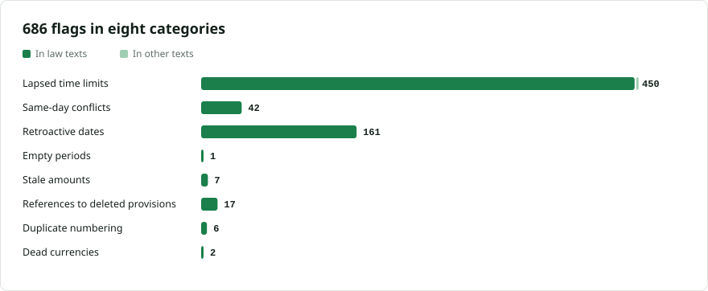

# Vulnerabilities in Azerbaijani law

[Azərbaycanca](README.md) · **English**

<picture>
<source media="(prefers-color-scheme: dark)" srcset="img/flags-by-category-dark.svg">

</picture>

The vulnerability detectors from [lexifina/global-law](https://github.com/lexifina/global-law/tree/main/vulnerabilities) look for mechanical mistakes in legislation: a rule applying "until" a date that has passed, a time limit extended only after it had run out, an amount changed in one place but not in another, two amendments to the same provision on the same day, a rule in force before it was published. global-law's published list (9 November 2026) covered Azerbaijan with 555 flags from an earlier copy of this repository: 280 same-day conflicts, 165 retroactive dates, 74 references to deleted provisions, 21 dead currencies, 6 duplicate numbers, 5 references to repealed placeholders, 3 stale amounts and 1 repeal gap, and no lapsed time limits, since its search did not read Azerbaijani dates. This is a run over this repository only, as it stood at commit [`6e21fc9`](https://github.com/lexifina/azerbaijan-law/commit/6e21fc97acde86122537dca2cfab4abb85c1fb29) on 15 November 2026.

**In short:** the detectors raised 686 flags, 685 of them in law texts. A language model reviewed 145 of the strongest, arguing each one for and against; 15 survived: 3 lapsed time limits, 3 same-day conflicts, 5 retroactive dates, 1 empty period and 3 stale amounts. Read by hand in this repository, none of the 15 is a drafting mistake. The empty period is no gap: Law No. 348-VIIQD moved the end of the moratorium on inspections of businesses from 1 January 2026 to 1 January 2027 and took effect on 9 February 2026, but it says itself that it applies from 1 January 2026. Five are lawful (that extension, two 1993 laws in force from the day they were signed or adopted, as they say, two additions made on one day to the same list in the Code of Administrative Offences, and a Tax Code penalty raised from 500 to 10,000 manat while other rules keep their own 500 manat), three are spent, two come from how this repository is built, two were misread by a detector (the old salaries of the chairman and the deputy chairman of the Chamber of Accounts, which stand only in the 2022 law that set them), and three take e-qanun's in-force date, the day the act is dated, for laws of 1994 and 1995 that name no day themselves. Of the other 130 reviewed flags, the model judged 63 lawful and 65 artefacts, and set aside 2 more on rebuttal. None of the 17 references to deleted provisions, read by hand, is a reference left behind: each cites an article that is still in the law but has no file of its own here. The model does not review the other categories; reading them turned up no mistake in the law. The hand check did find problems in this repository: the whole Competition Code is in the file of its last article, and 403 articles in 27 acts have no file of their own (see below). Later, this will be formalised in Lean, similar to our work on [the US tax code](https://lexifina.com/blog/formalizing-the-us-tax-code) and [US case law](https://lexifina.com/blog/formalizing-all-us-case-law-in-lean).

A flag is a prompt to look, not legal advice, and nothing here has been tested in court.

## Flags by category

| Category | What it looks for | Flags | In law texts | Reviewed | Survived review |
| --- | --- | ---: | ---: | ---: | ---: |
| Lapsed time limits | Text still applying a rule "until" a date that has passed | 450 | 449 | 40 | 3 |
| Same-day conflicts | Two acts changing the same provision on the same day | 42 | 42 | 40 | 3 |
| Retroactive or pre-publication dates | A rule in force before it was made or published | 161 | 161 | 40 | 5 |
| Empty periods | A time limit extended by an act that took effect after it had run out | 1 | 1 | 1 | 1 |
| Stale amounts | An amount changed in one place but still standing elsewhere | 7 | 7 | 7 | 3 |
| References to deleted provisions | A provision citing an article whose file is no longer in this repository | 17 | 17 | 17 | 0 |
| Duplicate numbering | Two units with the same number in one provision | 6 | 6 | 0 | 0 |
| Dead currencies | Amounts in currencies no longer in use | 2 | 2 | 0 | 0 |

"In law texts" counts every file under `konstitusiya/`, `referendum-akti/`, `konstitusiya-qanunu/`, `mecelle/` and `qanun/`: the Constitution, the referendum acts, constitutional laws, codes and laws, with e-qanun's notes at the end of each file. The repository's own files (`data/`, `tools/`, the READMEs, `REPRODUCE.md`, `LICENSE`, `corpus.json`, `laws.csv`) count as not law; the one other flag is a date in `README.en.md`. The search for lapsed time limits did not read Azerbaijani, where the date comes first and "until" is a suffix or a word after it ("2020-ci il dekabrın 31-dək", "31 dekabr 2020-ci il tarixinədək", "2020-ci il 1 yanvar tarixinə qədər", "2020-ci ilin sonunadək"), nor the deadlines "ən geci" and "... tarixdən gec olmayaraq" (not later than). With them, the current law files that hold such a phrase gave 495 time limits where they had given none, and 450 flags; e-qanun's notes, which quote earlier wording, are no longer read as the provision's text. It still leaves out phrases that give only a year ("2010-cu ilədək", 129 in the law files, notes included). The reference search now reads "Bu Qanunun 12.3-cü maddəsi" as Article 12 of the same law, "... Məcəlləsinin 5-ci maddəsi" as an article of another act, and "Qanunvericilik Toplusu, 2004-cü il, № 3, maddə 123" as a gazette entry, not Article 123. The search for references to repealed placeholders (5 flags in global-law's list) now skips e-qanun's notes and gazette entries too, and finds none. Of the 21 dead currencies in global-law's list, 20 were "inti" (the Peruvian inti) read inside "intizam" (discipline), "intihar" (suicide) and "tikinti" (construction), and one "dm" (dəniz mili, nautical miles) in a table of distances; the search now leaves out "inti" and "lira" (the Turkish lira, in use) in Azerbaijani, and no longer reads the plural ending in "2625-ları" as the Georgian lari, which also removes one of the list's stale amounts.

*Edge cases: the 15 flags that survived the review, grouped by what they turned out to be, the 130 that did not, and what the other flags are, in [EDGE-CASES.en.md](EDGE-CASES.en.md).*

## Problems found in this repository

- **A code in the file of its last article.** In the [Competition Code](https://github.com/lexifina/azerbaijan-law/blob/6e21fc97acde86122537dca2cfab4abb85c1fb29/mecelle/2023/56187/madde-84.md) (Rəqabət Məcəlləsi, 2023), the files of Articles 1 to 83 hold only the article's heading (some also the next chapter's heading), and `madde-84.md` holds the Code's whole text: Article 84's heading, then the preamble and Articles 1 to 84. It has been so since the Code's first version in this history (in force 1 July 2024). A file path, `git blame` and global-law's citations put every article of the Code in Article 84, and every amendment of the Code changes that one file.
- **Articles without a file of their own.** Where e-qanun spaces out the heading ("M a d d ə 40."), the article is not split off: 387 articles in 19 acts are in another article's file. The [Law on Banks](https://github.com/lexifina/azerbaijan-law/blob/6e21fc97acde86122537dca2cfab4abb85c1fb29/qanun/2004/590-IIQ/madde-39.md) (No. 590-IIQ, 2004) has seven files, `title.md` and those of Articles 5, 11, 15, 22, 38 and 39, the last holding Articles 40 to 94; this history removed 24 of its article files in a change credited to no act (`Kind: unexplained`, dated 11 April 2025). The Law on Service in the Justice Bodies (No. 119-IIIQ, 2006) is a single [`title.md`](https://github.com/lexifina/azerbaijan-law/blob/6e21fc97acde86122537dca2cfab4abb85c1fb29/qanun/2006/119-IIIQ/title.md) with 43 article headings. A note mark right after the number ("Maddə 16[^1]") or before the heading ("[^2]Maddə 9.") has the same effect for 16 more articles in 8 acts, among them Articles 1, 4, 8 and 16 of the Nakhchivan Agreement on the Cooperation Council of Turkic-Speaking States (Law No. 913-IIIQ, 2009; Article 16 is [in the file of Article 15](https://github.com/lexifina/azerbaijan-law/blob/6e21fc97acde86122537dca2cfab4abb85c1fb29/qanun/2009/913-IIIQ/madde-15.md)) and Articles 2 and 5 of Law No. 779-IQ approving the Civil Code. Every one of the 17 references to deleted provisions points at such an article.
- **The end of an HTML tag as a file's first line.** 173 files begin with the remains of the source page's `<body>` tag, such as "body lang=RU link=blue vlink=purple style='tab-interval:36.0pt'>"; the [Water Code](https://github.com/lexifina/azerbaijan-law/blob/6e21fc97acde86122537dca2cfab4abb85c1fb29/mecelle/1997/46940/title.md) begins "-LATIN link=blue vlink=purple style='tab-interval:35.4pt'>".

## Files

| File | What it holds |
| --- | --- |
| [data/flags.csv](data/flags.csv) | Every flag, one row per provision and issue |
| [data/reviewed.csv](data/reviewed.csv) | The 145 flags the model reviewed, with its verdict and reason |
| [data/by_category.csv](data/by_category.csv) | The counts in the table above |
| [tools/](tools/) | The scripts that made this run |

Columns: `category` and `category_az` (the category in English and Azerbaijani), `detector`, `kind` (`law` or `other`), `path` (the file in this repository; for a retroactive date, the first file of the act), `date` (the date the flag turns on; for a reference to a deleted provision, the last date its target is in the record), `reference` (the act or line involved), `summary`, `score` (the detector's ranking, 0 to 1), `review` (`artefact`, `lawful` or `candidate_defect`), `survives_rebuttal`, `review_note` (the model's reason, in English), `url` (the provision at the commit that was read, under its folder since act folders were renamed on 10 November 2026, or, for a retroactive date, the commit of the act).

## How it was made

- **Detectors:** global-law's [vulnerabilities/scripts](https://github.com/lexifina/global-law/tree/main/vulnerabilities/scripts), run on this repository at commit `6e21fc9`. global-law replays this repository only up to an earlier commit, so the history table the detectors read was built from this repository's own commits (the act that made each change, its `In-force` date and its `Kind`). This repository moved its act folders on 10 November 2026 and every earlier commit names a file by its old folder, so each path was mapped to its folder since the move (`data/paths.json`) before the detectors ran. The detectors carry the fixes global-law's scripts received in the runs on other country repositories, and fixes for Azerbaijani: the dates, references, amounts and currency words above.
- **Model review:** gpt-5.4-mini, the 40 strongest flags per category, and for lapsed time limits also the 40 strongest in law texts, which are the same 40; one pass says whether a flag is real, a second argues that it is not. Categories with fewer flags (the empty period, the stale amounts, the references to deleted provisions) were reviewed in full. The model does not review duplicate numbering or dead currencies. global-law's own list used a different model.
- **Hand check:** every flag that survived was read in this repository's history and texts, with the amending acts' own texts where this repository holds them: for the empty period, Law No. 348-VIIQD and the five earlier laws that moved the same date (Nos. 279-VIQD, 480-VIQD, 803-VIQD, 1084-VIQD and 134-VIIQD); for the retroactive dates, the entry-into-force wording of all five acts. All 17 references to deleted provisions were read with the files they point to, and so were the 6 duplicate numbers and the 2 dead currencies. The other reviewed flags were read in the passage the detector quoted.

To report a correction, open an issue with the provision and an official source.

## Licence

The lists and notes are Lexifina's, dedicated to the public domain under CC0 1.0, like the rest of this repository's own contributions. Quoted law text is as e-qanun.az, the Ministry of Justice's database of legal acts, publishes it; under Article 7(a) of the Law on Copyright and Related Rights (No. 115-IQ, 5 June 1996), laws and other official texts of a legislative, administrative or judicial nature are not objects of copyright; see [LICENSE](../LICENSE).
