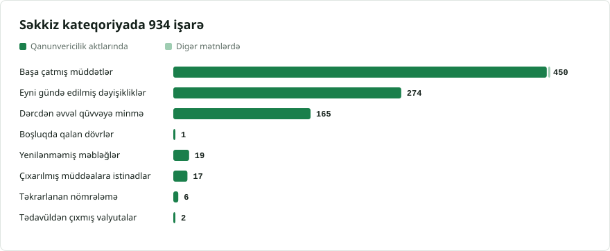

# Azərbaycan qanunvericiliyində zəif yerlər

**Azərbaycanca** · [English](README.en.md)

<picture>
<source media="(prefers-color-scheme: dark)" srcset="img/flags-by-category-dark.az.svg">

</picture>

[lexifina/global-law](https://github.com/lexifina/global-law/tree/main/vulnerabilities) layihəsinin detektorları qanunvericilikdə mexaniki xətaları axtarır: tarixi artıq keçmiş "...-dək" müddətə hələ də istinad edən qayda, müddəti bitdikdən sonra uzadılan müddət, bir yerdə dəyişdirilib başqa yerdə əvvəlki kimi qalan məbləğ, eyni müddəaya eyni gündə edilmiş iki dəyişiklik, dərc edilməzdən əvvəl qüvvəyə minən qayda. global-law-un dərc etdiyi siyahı (9 noyabr 2026-cı il) Azərbaycanı bu repozitoriyanın daha əvvəlki nüsxəsi üzrə 555 işarə ilə əhatə edirdi: 280 eyni gündə edilmiş dəyişiklik, 165 dərcdən əvvəl qüvvəyə minmə, 74 çıxarılmış müddəaya istinad, 21 tədavüldən çıxmış valyuta, 6 təkrarlanan nömrə, 5 mətni çıxarılmış müddəaya istinad, 3 yenilənməmiş məbləğ və 1 qüvvədən düşmə boşluğu; başa çatmış müddət isə yox idi, çünki onun axtarışı Azərbaycan dilində yazılmış tarixləri oxumurdu. Bu, yalnız bu repozitoriya üzrə, onun 15 noyabr 2026-cı il tarixli [`6e21fc9`](https://github.com/lexifina/azerbaijan-law/commit/6e21fc97acde86122537dca2cfab4abb85c1fb29) commitindəki vəziyyəti üzrə aparılmış yoxlamadır.

**Qısaca:** detektorlar 934 işarə qoydu, onlardan 933-ü qanunvericilik aktlarındadır. Dil modeli ən güclü 165 işarəni nəzərdən keçirdi, hər birinin lehinə və əleyhinə arqument gətirdi; 25-i yoxlamadan keçdi: 3 başa çatmış müddət, 4 eyni gündə edilmiş dəyişiklik, 5 dərcdən əvvəl qüvvəyə minmə, 1 boşluqda qalan dövr və 12 yenilənməmiş məbləğ. Bu repozitoriyada əl ilə oxunduqda 25-dən heç biri hüquq-texniki xəta deyil. Boşluqda qalan dövr əslində boşluq deyil: № 348-VIIQD Qanun sahibkarlıq sahəsində yoxlamaların dayandırılması müddətinin sonunu 2026-cı il yanvarın 1-dən 2027-ci il yanvarın 1-nə keçirib və 2026-cı il fevralın 9-da qüvvəyə minib, lakin özü 2026-cı il yanvarın 1-dən tətbiq edildiyini müəyyən edir. Altısı qanunauyğundur (həmin uzadılma, imzalandığı və ya qəbul edildiyi gündən qüvvəyə mindiyini özü bildirən 1993-cü ilin iki qanunu, İnzibati Xətalar Məcəlləsində eyni siyahıya eyni gündə edilmiş iki əlavə və Vergi Məcəlləsində dəyişdirilmiş iki məbləğ, halbuki digər qaydalar öz məbləğlərini saxlayır: 500 manatdan 10.000 manata qaldırılmış maliyyə sanksiyası və № 1033-VIQD Qanunla 500 manatdan 300.000 manatadək vahid həddə gətirilmiş, müddətin uzadılması üçün müraciətə sənədlər əlavə edilməsini tələb edən borc hədləri, 100.000 manat isə başqa qaydalarda qalır), üçünün təsiri bitib, on biri bu repozitoriyanın qurulma qaydasından irəli gəlir (onlardan səkkizi Vergi Məcəlləsinin 101-ci maddəsində gəlir vergisi dərəcələrinin on səkkiz illik dəyişikliklərini bir addımda əks etdirən bir dəyişiklikdir), ikisini detektor səhv oxuyub (Hesablama Palatası sədrinin və sədr müavininin əvvəlki vəzifə maaşları yalnız onları müəyyən etmiş 2022-ci il qanununun mətnində qalıb), üçü isə özü qüvvəyə minmə günü göstərməyən 1994 və 1995-ci il qanunları üçün e-qanunun qüvvəyə minmə tarixini, yəni aktın tarixini götürür. Nəzərdən keçirilmiş digər 140 işarədən modelin qərarı ilə 68-i qanunauyğun, 70-i artefaktdır, daha 2-si isə təkzib mərhələsində kənara qoyulub. Əl ilə oxunmuş 17 çıxarılmış müddəaya istinadın heç biri unudulmuş istinad deyil: hər biri qanunda hələ də olan, lakin burada öz faylı olmayan maddəyə istinad edir. Model qalan kateqoriyaları nəzərdən keçirmir; onları oxuduqda qanunda xəta tapılmadı. Əl ilə yoxlama isə bu repozitoriyada problemlər aşkar etdi: Rəqabət Məcəlləsinin bütün mətni onun son maddəsinin faylındadır, 27 aktda 403 maddənin öz faylı yoxdur, 77 dəyişiklik onu edən qanunlardan sonrakı tarixlə qeyd olunub, Cinayət-Prosessual Məcəlləsinin iki maddəsinin mətnində isə qeydlərində göstərilən dəyişiklik yoxdur (aşağıya baxın). Sonradan bu, [ABŞ vergi məcəlləsi](https://lexifina.com/blog/formalizing-the-us-tax-code) və [ABŞ məhkəmə təcrübəsi](https://lexifina.com/blog/formalizing-all-us-case-law-in-lean) üzrə işimizə bənzər şəkildə Lean dilində formallaşdırılacaq.

İşarə yalnız diqqət yetirməyə əsasdır, hüquqi məsləhət deyil; burada heç nə məhkəmədə yoxlanılmayıb.

## Kateqoriyalar üzrə işarələr

| Kateqoriya | Nəyi axtarır | İşarələr | Qanunvericilik aktlarında | Nəzərdən keçirilib | Yoxlamadan keçib |
| --- | --- | ---: | ---: | ---: | ---: |
| Başa çatmış müddətlər | Tarixi keçmiş "...-dək" müddətə hələ də istinad edən mətn | 450 | 449 | 40 | 3 |
| Eyni gündə edilmiş dəyişikliklər | Eyni müddəanı eyni gündə dəyişən iki akt | 274 | 274 | 47 | 4 |
| Dərcdən əvvəl qüvvəyə minmə | Qəbul və ya dərc edilməzdən əvvəl qüvvədə olan qayda | 165 | 165 | 41 | 5 |
| Boşluqda qalan dövrlər | Müddəti bitdikdən sonra qüvvəyə minən aktla uzadılmış müddət | 1 | 1 | 1 | 1 |
| Yenilənməmiş məbləğlər | Bir yerdə dəyişdirilib, başqa yerdə əvvəlki kimi qalan məbləğ | 19 | 19 | 19 | 12 |
| Çıxarılmış müddəalara istinadlar | Faylı artıq bu repozitoriyada olmayan maddəyə istinad edən müddəa | 17 | 17 | 17 | 0 |
| Təkrarlanan nömrələmə | Bir müddəada eyni nömrəli iki bölmə | 6 | 6 | 0 | 0 |
| Tədavüldən çıxmış valyutalar | Artıq istifadə olunmayan valyutalarda göstərilmiş məbləğlər | 2 | 2 | 0 | 0 |

"Qanunvericilik aktlarında" sütunu `konstitusiya/`, `referendum-akti/`, `konstitusiya-qanunu/`, `mecelle/` və `qanun/` qovluqlarındakı bütün faylları əhatə edir: Konstitusiya, referendum aktları, konstitusiya qanunları, məcəllələr və qanunlar, hər faylın sonunda e-qanunun qeydləri ilə birlikdə. Repozitoriyanın öz faylları (`data/`, `tools/`, README faylları, `REPRODUCE.md`, `LICENSE`, `corpus.json`, `laws.csv`) qanunvericilik sayılmır; yeganə digər işarə `README.en.md` faylındakı tarixdir. Başa çatmış müddətlərin axtarışı Azərbaycan dilini oxumurdu: bu dildə əvvəl tarix gəlir, "...-dək" isə şəkilçi və ya ondan sonra gələn sözdür ("2020-ci il dekabrın 31-dək", "31 dekabr 2020-ci il tarixinədək", "2020-ci il 1 yanvar tarixinə qədər", "2020-ci ilin sonunadək"); "ən geci" və "... tarixdən gec olmayaraq" son müddətlərini də tanımırdı. Bunlar əlavə edildikdən sonra belə ifadə olan cari qanunvericilik faylları əvvəlki sıfır əvəzinə 495 müddət və 450 işarə verdi; əvvəlki redaksiyanı sitat gətirən e-qanun qeydləri isə artıq müddəanın mətni kimi oxunmur. Yalnız ili göstərən ifadələr ("2010-cu ilədək"; qeydlər daxil olmaqla qanunvericilik fayllarında 129) hələ də nəzərə alınmır. İstinadların axtarışı indi "Bu Qanunun 12.3-cü maddəsi" ifadəsini həmin qanunun 12-ci maddəsi, "... Məcəlləsinin 5-ci maddəsi" ifadəsini başqa aktın maddəsi, "Qanunvericilik Toplusu, 2004-cü il, № 3, maddə 123" ifadəsini isə 123-cü maddə deyil, rəsmi nəşrdəki yer kimi oxuyur. Mətni çıxarılmış müddəalara istinadların axtarışı (global-law-un siyahısında 5 işarə) indi e-qanunun qeydlərini və rəsmi nəşrdəki yerləri də nəzərə almır və belə istinad tapmır. global-law-un siyahısındakı 21 tədavüldən çıxmış valyutadan 20-si "intizam", "intihar" və "tikinti" sözlərinin içində oxunmuş "inti" (Peru intisi), biri isə məsafələr cədvəlindəki "dm" (dəniz mili) idi; axtarış indi Azərbaycan dilində "inti" və "lira" (dövriyyədə olan türk lirəsi) sözlərini nəzərə almır və "2625-ları" ifadəsindəki cəm şəkilçisini gürcü larisi kimi oxumur; bununla siyahıdakı yenilənməmiş məbləğlərdən biri də aradan qalxır.

*Kənar hallar: yoxlamadan keçmiş 25 işarə, nə olduğuna görə qruplaşdırılmış şəkildə, keçməmiş 140 işarə və qalan işarələrin nədən ibarət olduğu [EDGE-CASES.md](EDGE-CASES.md) faylındadır.*

## Bu repozitoriyada aşkar edilmiş problemlər

- **Son maddəsinin faylında yerləşən məcəllə.** [Rəqabət Məcəlləsində](https://github.com/lexifina/azerbaijan-law/blob/6e21fc97acde86122537dca2cfab4abb85c1fb29/mecelle/2023/56187/madde-84.md) (2023) 1–83-cü maddələrin faylları yalnız maddənin başlığından (bəziləri həm də növbəti fəslin başlığından) ibarətdir, `madde-84.md` faylı isə Məcəllənin bütün mətnini saxlayır: 84-cü maddənin başlığı, sonra preambula və 1–84-cü maddələr. Məcəllənin bu tarixçədəki ilk redaksiyasından (2024-cü il iyulun 1-dən qüvvədədir) bəri vəziyyət belədir. Fayl yolu, `git blame` və global-law-un istinadları Məcəllənin hər maddəsini 84-cü maddədə göstərir, Məcəlləyə edilən hər dəyişiklik də həmin yeganə faylı dəyişir.
- **Öz faylı olmayan maddələr.** e-qanun başlığı aralı hərflərlə yazdıqda ("M a d d ə 40."), maddə ayrıca fayla ayrılmır: 19 aktda 387 maddə başqa maddənin faylındadır. ["Banklar haqqında" Qanunun](https://github.com/lexifina/azerbaijan-law/blob/6e21fc97acde86122537dca2cfab4abb85c1fb29/qanun/2004/590-IIQ/madde-39.md) (№ 590-IIQ, 2004) yeddi faylı var: `title.md` və 5, 11, 15, 22, 38 və 39-cu maddələrin faylları; sonuncusu 40–94-cü maddələri saxlayır; bu tarixçə onun 24 maddə faylını heç bir akta aid edilməyən dəyişikliklə (`Kind: unexplained`, 2025-ci il 11 aprel tarixli) silib. "Ədliyyə orqanlarında qulluq keçmə haqqında" Qanun (№ 119-IIIQ, 2006) 43 maddə başlığı olan yeganə [`title.md`](https://github.com/lexifina/azerbaijan-law/blob/6e21fc97acde86122537dca2cfab4abb85c1fb29/qanun/2006/119-IIIQ/title.md) faylından ibarətdir. Nömrədən dərhal sonra ("Maddə 16[^1]") və ya başlıqdan əvvəl ("[^2]Maddə 9.") gələn qeyd işarəsi 8 aktda daha 16 maddə üçün eyni nəticəyə gətirib, o cümlədən "Türkdilli Dövlətlərin Əməkdaşlıq Şurasının yaradılması haqqında" Naxçıvan Sazişinin 1, 4, 8 və 16-cı maddələri (№ 913-IIIQ Qanun, 2009; 16-cı maddə [15-ci maddənin faylındadır](https://github.com/lexifina/azerbaijan-law/blob/6e21fc97acde86122537dca2cfab4abb85c1fb29/qanun/2009/913-IIIQ/madde-15.md)) və Mülki Məcəlləni təsdiq edən № 779-IQ Qanunun 2 və 5-ci maddələri. 17 çıxarılmış müddəaya istinadın hamısı belə maddələrə yönəlib.
- **Faylın birinci sətri kimi HTML teqinin qalığı.** 173 fayl mənbə səhifəsinin `<body>` teqinin qalığı ilə başlayır, məsələn: "body lang=RU link=blue vlink=purple style='tab-interval:36.0pt'>"; [Su Məcəlləsi](https://github.com/lexifina/azerbaijan-law/blob/6e21fc97acde86122537dca2cfab4abb85c1fb29/mecelle/1997/46940/title.md) "-LATIN link=blue vlink=purple style='tab-interval:35.4pt'>" sətri ilə başlayır.
- **Onları edən qanunlardan sonrakı tarixlə qeyd olunmuş dəyişikliklər.** Fayl e-qanunun iki redaksiyası arasında dəyişdikdə və e-qanunun qeydləri yeni olaraq birdən çox aktı adlandırdıqda, bu tarixçə aktların heç birinə aid edilməyən və onlardan ən sonuncusunun tarixi ilə qeyd olunan bir commit (`Kind: several`) yaradır; belə commitlər 1.041-dir. Onlardan 77-si adlandırdığı bütün aktlardan sonrakı tarixlə qeyd olunub. 5 dekabr 2023-cü il tarixli № 1033-VIQD Qanun 2024-cü il yanvarın 1-dən qüvvəyə minib (3.5-ci maddə) və [Vergi Məcəlləsinin 85.9-cu maddəsindəki](https://github.com/lexifina/azerbaijan-law/blob/6e21fc97acde86122537dca2cfab4abb85c1fb29/mecelle/2000/46948/madde-85.md) borc hədlərini vahid həddlə əvəz edib; burada bu dəyişiklik 2025-ci il yanvarın 1-dən qüvvəyə minir. [Cinayət-Prosessual Məcəlləsinin](https://github.com/lexifina/azerbaijan-law/blob/6e21fc97acde86122537dca2cfab4abb85c1fb29/mecelle/2000/46950/madde-421.md) 2020-ci il martın 1-dən qüvvəyə minmiş № 1711-VQD Qanunla (2-ci maddə) əlavə edilmiş 421.1.4-cü maddəsi burada 2020-ci il iyulun 15-dən görünür.
- **Qeydlərdə olan, mətndə olmayan dəyişiklik.** 2020-ci il iyulun 15-dən qüvvəyə minmiş 25 iyun 2020-ci il tarixli № 140-VIQD Qanun Cinayət-Prosessual Məcəlləsinin 418.2.3 və 418.4-cü maddələrini ləğv edib (1.47.2-ci maddə), 421.1.1-ci maddədən isə "418.2.3," və "418.4," rəqəmlərini çıxarıb (1.48-ci maddə). Hər iki fayldakı e-qanun qeydləri bunu göstərir, lakin buradakı mətndə [418-ci maddənin hər iki bəndi](https://github.com/lexifina/azerbaijan-law/blob/6e21fc97acde86122537dca2cfab4abb85c1fb29/mecelle/2000/46950/madde-418.md) və 421.1.1-ci maddədə hər iki rəqəm hələ də qalır.

## Fayllar

| Fayl | Nəyi saxlayır |
| --- | --- |
| [data/flags.csv](data/flags.csv) | Bütün işarələr, hər müddəa və məsələ üçün bir sətir |
| [data/reviewed.csv](data/reviewed.csv) | Modelin nəzərdən keçirdiyi 165 işarə, onun qərarı və əsaslandırması ilə |
| [data/by_category.csv](data/by_category.csv) | Yuxarıdakı cədvəlin rəqəmləri |
| [tools/](tools/) | Bu yoxlamanı aparmış skriptlər |

Sütunlar: `category` və `category_az` (kateqoriya ingilis və Azərbaycan dillərində), `detector`, `kind` (`law` və ya `other`), `path` (bu repozitoriyadakı fayl; dərcdən əvvəl qüvvəyə minmə üçün aktın ilk faylı), `date` (işarənin aid olduğu tarix; çıxarılmış müddəaya istinad üçün hədəfin qeyddə sonuncu dəfə olduğu tarix), `reference` (müvafiq akt və ya sətir), `summary`, `score` (detektorun qiymətləndirməsi, 0-dan 1-ə qədər), `review` (`artefact`, `lawful` və ya `candidate_defect`), `survives_rebuttal`, `review_note` (modelin əsaslandırması, ingilis dilində), `url` (oxunmuş commitdə müddəa, akt qovluqlarının 10 noyabr 2026-cı ildə dəyişdirilmiş adı ilə, dərcdən əvvəl qüvvəyə minmə üçün isə aktın commiti).

## Necə hazırlanıb

- **Detektorlar:** global-law-un [vulnerabilities/scripts](https://github.com/lexifina/global-law/tree/main/vulnerabilities/scripts) skriptləri bu repozitoriyada `6e21fc9` commitində işə salınıb. global-law bu repozitoriyanı yalnız daha əvvəlki commitə qədər təkrarlayır, ona görə də detektorların oxuduğu tarixçə cədvəli bu repozitoriyanın öz commitlərindən qurulub (hər dəyişikliyi edən akt, onun `In-force` tarixi və `Kind` dəyəri). Bu repozitoriya akt qovluqlarını 10 noyabr 2026-cı ildə köçürüb, ondan əvvəlki hər commit isə faylı köhnə qovluğu ilə adlandırır; ona görə də detektorlar işə düşməzdən əvvəl hər yol köçürmədən sonrakı qovluğuna uyğunlaşdırılıb (`data/paths.json`). Tarixçə qanunvericiliyi dəyişən hər commiti qanunvericilik kimi sayır, cəmi 8.029 commit; bu siyahının ilk variantı bütöv aktların qüvvədən düşməsini (`Kind: repeal`, 76 commit) və bir neçə akta aid edilən dəyişiklikləri (`Kind: several`, 1.041 commit) nəzərə almırdı, detektorlar onlarla birlikdə yenidən işə salınıb. Detektorlar global-law skriptlərinin digər ölkə repozitoriyalarında aparılmış yoxlamalarda aldığı düzəlişləri və Azərbaycan dili üçün düzəlişləri daşıyır: yuxarıda göstərilən tarixlər, istinadlar, məbləğlər və valyuta sözləri.
- **Modelin nəzərdən keçirməsi:** gpt-5.4-mini, hər kateqoriyada ən güclü 40 işarə, başa çatmış müddətlər üçün isə həm də qanunvericilik aktlarındakı ən güclü 40 işarə (bunlar eyni 40 işarədir); birinci mərhələ işarənin real olub-olmadığını deyir, ikinci mərhələ onun real olmadığını əsaslandırmağa çalışır. Daha az işarəsi olan kateqoriyalar (boşluqda qalan dövr, yenilənməmiş məbləğlər, çıxarılmış müddəalara istinadlar) tam nəzərdən keçirilib. Detektorlar yenidən işə salındıqda artıq verilmiş qiymətləndirmələr saxlanılıb və yalnız ən güclü yeni işarələr nəzərdən keçirilib, ona görə də 47 eyni gündə edilmiş dəyişiklik və 41 dərcdən əvvəl qüvvəyə minmə nəzərdən keçirilib. Model təkrarlanan nömrələməni və tədavüldən çıxmış valyutaları nəzərdən keçirmir. global-law-un öz siyahısı başqa modellə hazırlanıb.
- **Əl ilə yoxlama:** yoxlamadan keçmiş hər işarə bu repozitoriyanın tarixçəsində və mətnlərində, bu repozitoriyada olduqda dəyişiklik edən aktların öz mətnləri ilə birlikdə oxunub: boşluqda qalan dövr üçün № 348-VIIQD Qanun və həmin tarixi əvvəllər dəyişmiş beş qanun (№ 279-VIQD, 480-VIQD, 803-VIQD, 1084-VIQD və 134-VIIQD); dərcdən əvvəl qüvvəyə minmə üçün beş aktın hamısının qüvvəyə minmə müddəaları; ikinci yoxlamanın əlavə etdiyi işarələr üçün onların əsasında duran `Kind: several` commitləri və № 1033-VIQD və № 1711-VQD qanunlar. 17 çıxarılmış müddəaya istinadın hamısı yönəldikləri fayllarla birlikdə oxunub, 6 təkrarlanan nömrə və 2 tədavüldən çıxmış valyuta da oxunub. Nəzərdən keçirilmiş digər işarələr detektorun sitat gətirdiyi hissədə oxunub.

Düzəliş təklif etmək üçün müddəanı və rəsmi mənbəni göstərməklə issue açın.

## Lisenziya

Siyahılar və qeydlər Lexifina-ya məxsusdur və bu repozitoriyanın digər öz töhfələri kimi CC0 1.0 əsasında ictimai mülkiyyətə verilib. Sitat gətirilən qanun mətni Ədliyyə Nazirliyinin hüquqi aktlar bazası olan e-qanun.az-ın dərc etdiyi kimidir; "Müəllif hüququ və əlaqəli hüquqlar haqqında" Qanunun (№ 115-IQ, 5 iyun 1996-cı il) 7-ci maddəsinin a) bəndinə əsasən qanunlar və qanunvericilik, inzibati və ya məhkəmə xarakterli digər rəsmi mətnlər müəllif hüququnun obyekti deyil; [LICENSE](../LICENSE) faylına baxın.
